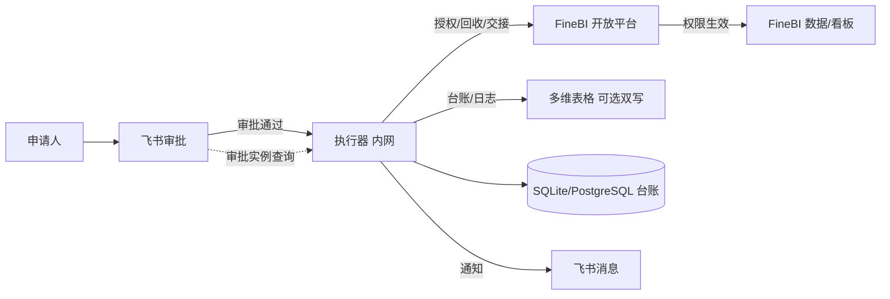
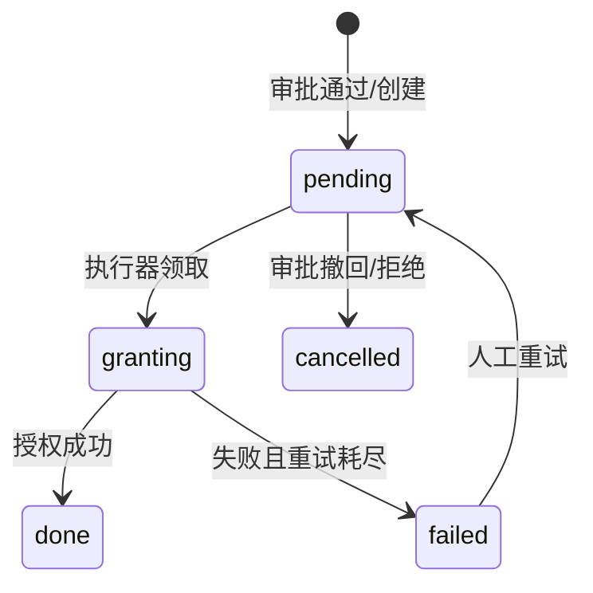

# FineBI × 飞书 数据权限自动化项目需求书

> **文档用途**：作为「高级 AI / 设计方」的输入，用于产出系统设计（架构、模块、接口契约、数据模型、部署与测试方案）。
> **项目现状**：已有可运行脚手架（`本仓库`），包含接口封装、授权/回收/到期/离职编排、CLI/HTTP API 与 11 个单测；本需求书描述**目标需求与约束**，设计方可基于现有骨架优化或重构。
> **一句话目标**：员工在飞书提交一次权限申请，审批通过后由内网执行器自动完成 FineBI 授权、台账登记、到期回收与离职清理，全程可追溯。

---

## 目录

1. [项目背景与目标](#1-项目背景与目标)
2. [范围与边界](#2-范围与边界)
3. [用户角色与业务场景](#3-用户角色与业务场景)
4. [功能需求](#4-功能需求)
5. [非功能需求](#5-非功能需求)
6. [系统架构与集成约束](#6-系统架构与集成约束)
7. [数据模型](#7-数据模型)
8. [权限模型与 CRUD 矩阵](#8-权限模型与-crud-矩阵)
9. [业务规则与状态机](#9-业务规则与状态机)
10. [接口清单与约束](#10-接口清单与约束)
11. [交付物与验收](#11-交付物与验收)
12. [实施计划](#12-实施计划)
13. [风险与开放问题](#13-风险与开放问题)
14. [相关文档与附件位置](#14-相关文档与附件位置)
15. [给设计方的任务说明](#15-给设计方的任务说明)
- [附录 A 术语表](#附录-a-术语表)

---

## 1. 项目背景与目标

### 1.1 现状与问题

| 问题 | 表现 | 影响 |
|---|---|---|
| 申请流程线下化 | IM/邮件提需求，口头或邮件审批，管理员后台手工配置 | 平均 1–3 天，跨部门更久；过程无记录 |
| 审批与执行脱节 | 审批同意不等于已配置，配置了也可能没审批 | 责任无法落地，审计对不上 |
| 权限只增不减 | 无到期机制，离职/转岗权限残留 | 数据暴露面持续扩大 |
| 台账缺失 | Excel 或没有台账，无法按人/资源查询 | 审计、对账、追责困难 |
| 角色化不足 | 按人逐条授权，权限碎片化 | 管理成本高，回收易漏 |

### 1.2 项目目标

| 编号 | 目标 | 度量口径 |
|---|---|---|
| G1 | 权限申请线上化 | 新增申请 100% 走飞书审批，可查询、可导出 |
| G2 | 授权自动化 | 审批通过后 ≤5 分钟完成授权（P95；轮询默认 2 分钟） |
| G3 | 到期回收 | 到期后 24 小时内回收，回收率 100%（行权限清空若采用 manual 策略，最后一条规则依赖人工，需注明） |
| G4 | 全链路可追溯 | 任一授权可还原：申请单 → 审批记录 → 执行日志（traceId）→ FineBI 操作日志 |
| G5 | 权限治理 | 角色化授权覆盖试点范围内 ≥60%，个人直授条目下降 |

### 1.3 成功衡量指标（试点 1 个月）

- 申请到授权平均时长 ≤10 分钟；
- 到期回收率 100%，无过期未回收；
- 离职权限 24 小时内清零；
- 审计抽样 20 条全部可追溯；
- 执行器接口成功率 ≥99%（可自动重试的失败计为一次）。

---

## 2. 范围与边界

### 2.1 范围内

1. 飞书审批：申请表单、条件分支、审批人/抄送人/办理人、审批实例数据获取。
2. 飞书多维表格：资源目录、申请台账、授权台账、执行日志、用户映射（可选双写）。
3. 内网执行器：
   - 审批结果轮询与表单解析；
   - FineBI 授权（文件夹、数据集、行权限、列权限、仪表板查看/导出、分享、组件数据、主题协作）；
   - 角色自动分配；
   - 到期回收、续期、主动退权；
   - 离职/转岗资源交接与权限回收；
   - 台账、日志、通知、失败重试。
4. 配置与运维：环境配置、资源目录配置、表单字段映射、CLI/HTTP API、定时任务、dry-run。
5. 对账与月报：台账 vs FineBI 现状核对，输出差异清单。

### 2.2 范围外

- FineBI 账号开户、角色创建、部门/岗位维护（由 HR/LDAP/AD 同步负责；执行器可调用接口，但不负责主数据）。
- 数据源接入、数据集建模、数据准备、脱敏规则（属于数据开发）。
- 非权限类审批（采购、报销等）。
- 飞书审批自动化直接调用 FineBI（平台能力不支持）。
- 多维表格自动化 HTTP 直连内网 FineBI（平台限制不允许）。

### 2.3 前置假设与依赖

| 编号 | 假设/依赖 | 不成立时的影响 |
|---|---|---|
| A1 | FineBI 开放平台已启用权限类接口与平台公共接口，具备可用的 `clientId/secret` | 无法授权/回收，需先开通 |
| A2 | 飞书企业版，审批与多维表格可用；审批后台支持“引用多维表格”控件 | 资源选择退化为静态选项 |
| A3 | 有 1 台内网服务器（2C4G 起）可部署执行器，可出站访问 `open.feishu.cn` | 无法自动执行 |
| A4 | 飞书用户与 FineBI 账号可建立稳定映射（工号/邮箱/手机号） | 无法定位授权对象 |
| A5 | 存在资源 Owner 清单（谁负责哪个资源） | 审批人退化为部门负责人 |
| A6 | 客户审批表单字段可配置映射 | 需定制解析逻辑 |

---

## 3. 用户角色与业务场景

### 3.1 角色定义

| 角色 | 职责 | 主要界面 |
|---|---|---|
| 申请人 | 发起权限申请、填写范围与期限、查看进度 | 飞书审批（移动/桌面） |
| 直属上级 | 一级审批，确认业务必要性 | 飞书审批 |
| 数据 Owner | 按资源审批，确认数据范围与敏感级别 | 飞书审批 / 多维表格 |
| 数据安全/合规 | 敏感字段、导出、长期限、全量范围的加签 | 飞书审批 |
| BI 管理员 | 高风险/管理授权特批、异常兜底、对账处理 | 飞书审批 / 执行器管理页 |
| 审计员 | 只读查询申请、授权、回收记录 | 多维表格 / 报表 |
| 系统执行器 | 自动授权、回收、交接、写台账 | 服务端 |
| 飞书管理员 | 审批定义、表单/流程、应用权限配置 | 飞书管理后台 |
| HR/部门负责人 | 离职/转岗触发与接收人确认 | 飞书人事/审批 |

### 3.2 典型业务场景（权限自动化）

| 编号 | 场景 | 关键点 |
|---|---|---|
| S1 | 新人/新岗位申请数据使用：文件夹或数据集“使用”权限，默认 90 天 | 上级 + 数据 Owner 审批，到期回收 |
| S2 | 大促临时扩权：按渠道/店铺授予数据集使用 + 行权限，30/60 天 | 审批通过后自动授权，到期自动收回 |
| S3 | 区域/渠道数据隔离：同一数据集按大区、渠道授予不同行范围 | 多单并行时行权限合并，不互相覆盖 |
| S4 | 敏感字段与导出：列权限（组件数据）+ 仪表板导出 | 导出单独审批，敏感字段加签数据安全 |
| S5 | 仪表板查看/导出：按模板认证控制 view/export | 查看与导出互斥校验 |
| S6 | 离职/转岗：资源交接 + 全部权限回收 + 账号禁用 | 24 小时内闭环，生成清理报告 |

> 本需求书只覆盖上述权限自动化链路（申请 → 审批 → 授权 → 到期/离职回收 → 审计）。

---

## 4. 功能需求

> 优先级：**M**=Must（一期必须）、**S**=Should（二期）、**C**=Could（可延后）。
> 每条需求可测试；验收时按编号逐条确认。

### 4.1 审批与申请

| 编号 | 需求 | 优先级 | 验收标准 |
|---|---|---|---|
| FR-APP-01 | 审批表单包含：申请类型、数据资源（引用多维表格）、权限项、数据范围、期限、理由、敏感标识、导出标识、FineBI 账号 | M | 表单可提交，字段完整；引用控件带出资源 ID/Owner |
| FR-APP-02 | 条件分支按风险分级：低（使用/查看，≤90 天）/中（行权限、导出、>90 天）/高（敏感、>180 天）/特批（管理/授权） | M | 不同取值走不同审批链 |
| FR-APP-03 | 审批人支持：直属上级、数据 Owner（表单内联系人）、数据安全、BI 管理员；支持会签/或签/依次 | M | 各类型可配置并生效 |
| FR-APP-04 | 办理人节点仅用于异常兜底，不作为正式授权步骤 | S | 正式流程无办理人阻塞 |
| FR-APP-05 | 审批通过/拒绝/撤回后，执行器能获取实例状态与表单值 | M | `instances/query` + `instances/:id` 解析成功 |
| FR-APP-06 | 审批实例去重：同一实例只处理一次；失败可重试 | M | 重复轮询不产生重复台账 |

### 4.2 资源目录与权限模板

| 编号 | 需求 | 优先级 | 验收标准 |
|---|---|---|---|
| FR-RES-01 | 资源目录字段：资源 ID、类型、名称、路径、Owner、敏感级别、字段清单、状态 | M | 目录可维护、可查询 |
| FR-RES-02 | 资源目录可从 FineBI 同步（文件夹树、数据集信息、仪表板列表） | S | 同步后资源 ID/路径正确 |
| FR-RES-03 | 权限模板：预设权限项集合、默认期限、风险级别、默认角色 | M | 申请时可套用模板 |

### 4.3 授权执行

| 编号 | 需求 | 优先级 | 验收标准 |
|---|---|---|---|
| FR-GRN-01 | 用户解析：飞书账号 → 工号/邮箱 → FineBI 用户；未映射时转人工 | M | 映射表可维护；失败不重试 |
| FR-GRN-02 | 文件夹/数据集“使用/管理/授权/组件数据”权限设置 | M | 设置后查询接口返回 true |
| FR-GRN-03 | 行权限授权：读现状 → 合并本次规则 → 整体写回（接口全量覆盖） | M | 两单叠加后规则为并集，不互相覆盖 |
| FR-GRN-04 | 列权限授权（组件数据） | M | 查询接口返回 `biData=true` |
| FR-GRN-05 | 仪表板查看/导出：查看关闭必须导出关闭；导出开启必须查看开启 | M | 非法组合在执行前被拒绝 |
| FR-GRN-06 | 公共链接分享、仪表板分享、目录组件数据权限、主题协作 | S | 对应接口设置成功 |
| FR-GRN-07 | 角色自动分配：审批通过后把用户加入目标角色（`PUT /v3/user/role`） | M | 用户角色查询可见 |
| FR-GRN-08 | 幂等：写前查询现状，已存在则跳过并记录 | M | 重复执行不重复写入、不重复台账 |
| FR-GRN-09 | 写后复核：写入后再次查询，不一致则重试并告警 | M | 复核失败进入重试/人工 |
| FR-GRN-10 | 父子目录一致性校验：父目录有“授权”时子目录不得关闭 | M | 非法组合执行前拦截 |
| FR-GRN-11 | 存量直授权限处理：现状已满足但无台账时，`ADOPT_EXISTING=false` 记 skipped、通知 Owner、列入对账差异 | S | 不建台账、不参与到期回收 |

### 4.4 到期回收与续期

| 编号 | 需求 | 优先级 | 验收标准 |
|---|---|---|---|
| FR-REV-01 | 每日扫描到期台账（可配置时间） | M | 到期记录被识别 |
| FR-REV-02 | 回收普通权限（置 false），行权限按剩余规则重算 | M | 回收后查询接口为 false；其他规则保留 |
| FR-REV-03 | 行权限清空策略（空 filter / 固定规则 / 人工）按 POC 结论实现 | M | 回收后无残留，或明确转人工 |
| FR-REV-04 | 续期：延长台账到期时间并补授权 | S | 续期后台账时间正确 |
| FR-REV-05 | 主动退权：支持按台账/按用户回收 | S | 回收成功并留痕 |

### 4.5 离职/转岗

| 编号 | 需求 | 优先级 | 验收标准 |
|---|---|---|---|
| FR-OFF-01 | 触发源：飞书人事/HR webhook/离职审批/每周在职比对（兜底） | M | 任一触发可启动流程 |
| FR-OFF-02 | 资源交接：查询我的分析/公共数据待交接资源，指定接收人并交接 | M | 交接接口返回 `failResource` 为空 |
| FR-OFF-03 | 回收该用户全部有效台账权限（含未到期） | M | 台账状态全部 revoked |
| FR-OFF-04 | 禁用 FineBI 用户（`PUT /v3/user/enable`） | M | 用户状态为禁用 |
| FR-OFF-05 | 生成清理报告并通知 HR/部门/审计 | M | 报告含资源清单、回收结果、失败项 |

### 4.6 台账与审计

| 编号 | 需求 | 优先级 | 验收标准 |
|---|---|---|---|
| FR-LED-01 | 申请台账：单号、实例码、申请人、资源、权限项、状态、时间 | M | 可查询、可导出 |
| FR-LED-02 | 授权台账：用户、资源、权限项、规则、来源申请、生效/到期、状态 | M | 与 FineBI 现状可核对 |
| FR-LED-03 | 执行日志：接口、请求摘要、响应、traceId、重试次数 | M | 可按 traceId 检索 |
| FR-LED-04 | 审计查询：按人/资源/时间/状态组合筛选 | S | 结果正确 |
| FR-LED-05 | 月报：申请量、通过率、时长、回收数、异常数 | S | 可导出 |

### 4.7 通知与人工兜底

| 编号 | 需求 | 优先级 | 验收标准 |
|---|---|---|---|
| FR-NOT-01 | 授权成功/失败/到期/离职清理通知（飞书卡片或消息） | M | 相关人员收到 |
| FR-NOT-02 | 失败重试 3 次（1/5/15 分钟退避），仍失败转人工待办 | M | 日志可见重试过程 |
| FR-NOT-03 | 管理端人工操作：重试、强制回收、补录台账 | S | 操作留痕 |

### 4.8 对账

| 编号 | 需求 | 优先级 | 验收标准 |
|---|---|---|---|
| FR-REC-01 | 按台账逐条调用查询接口比对，输出差异清单（有台账无权限/无台账有权限/值不一致） | S | 差异可人工处理并回写 |

### 4.9 配置管理

| 编号 | 需求 | 优先级 | 验收标准 |
|---|---|---|---|
| FR-CFG-01 | 凭证从环境变量/`.env` 读取，不入库、不进日志 | M | 日志中无明文 |
| FR-CFG-02 | 表单字段映射、资源类型映射、动作映射可配置 | M | 改配置不改代码 |
| FR-CFG-03 | 资源目录可配置文件维护或同步生成 | M | 资源 ID 可解析 |
| FR-CFG-04 | dry-run 模式：只打印意图不写接口 | M | 默认开启；关闭需显式配置 |

### 4.10 运维接口

| 编号 | 需求 | 优先级 | 验收标准 |
|---|---|---|---|
| FR-OPS-01 | CLI：check / grant / revoke / expire / offboard / poll / serve | M | 命令可执行，返回 JSON |
| FR-OPS-02 | HTTP API：/health、/grant、/revoke、/expire、/offboard、/poll | S | 接口可用，鉴权可加 |
| FR-OPS-03 | 定时任务：poll 2–5 分钟、expire 每日 | M | 计划任务配置文档齐全 |
| FR-OPS-04 | 健康检查与结构化日志 | S | 可被监控采集 |

---

## 5. 非功能需求

| 编号 | 类别 | 要求 |
|---|---|---|
| NFR-PERF-01 | 性能 | 单次授权（含查询+写入+复核）≤3 秒（内网 P95）；单批 ≤100 条 |
| NFR-PERF-02 | 性能 | 审批轮询间隔 2–5 分钟可配置；查询时间窗 ≤30 天 |
| NFR-AVAIL-01 | 可用性 | 工作时间可用性 ≥99.5%；进程崩溃后可恢复，任务可重跑 |
| NFR-SEC-01 | 安全 | 凭证仅环境变量/密钥管理；代码、日志、台账不含明文 |
| NFR-SEC-02 | 安全 | 仅内网部署；出站仅 `open.feishu.cn` 与 FineBI；不开放 FineBI 公网入口 |
| NFR-SEC-03 | 安全 | 使用专用“权限机器人”账号 + `decUser`，接口权限最小化 |
| NFR-AUD-01 | 审计 | 申请/授权/回收/交接全留痕；日志保留 ≥180 天（可配置） |
| NFR-MNT-01 | 可维护 | 配置与代码分离；关键路径有日志与错误码；支持 dry-run |
| NFR-COMPAT-01 | 兼容 | 仅使用所附接口文档中的公开接口，不依赖未公开接口；接口变更需回归 |
| NFR-DEPLOY-01 | 部署 | Windows Server / Linux 均可；Python 3.10+；默认 SQLite，可替换 PostgreSQL |
| NFR-I18N-01 | 易用 | 错误提示可读（中文），包含资源/用户/接口信息，便于管理员处理 |

---

## 6. 系统架构与集成约束

### 6.1 逻辑架构

### 6.2 组件职责

| 组件 | 职责 | 不负责 |
|---|---|---|
| 飞书审批 | 表单、流程、审批人、抄送、留痕 | 授权执行、到期管理 |
| 多维表格 | 资源目录、台账展示、提醒（可选） | 调用 FineBI |
| 执行器 | 轮询审批、解析表单、授权/回收/交接、台账、重试 | 审批决策 |
| FineBI 开放平台 | 权限存储与生效、用户与角色、资源交接 | 审批、有效期 |
| 台账库 | 申请/授权/日志持久化 | 权限判断 |

### 6.3 网络与部署约束

- 执行器部署在内网，主动出站访问飞书开放平台（443）与 FineBI（内网地址）。
- 不为 FineBI 开放公网入口；不依赖飞书回调地址（轮询方案）。
- 1 台 2C4G 起步；数据库与执行器可同机；日志目录与数据目录分离。
- 定时任务：`poll` 每 2–5 分钟；`expire` 每日 09:00；`poll` 与 `expire` 可并行。

### 6.4 平台能力约束（设计必须遵守）

| 编号 | 约束 | 设计含义 |
|---|---|---|
| C-01 | 飞书审批自动化只能“发起新审批/发消息”，不能调 API、不能写表格 | 审批结果由执行器轮询获取，不依赖审批自动化 |
| C-02 | 多维表格 HTTP 请求不支持内网 URL | 不能由多维表格直连 FineBI；执行器必须在内网 |
| C-03 | 行权限接口是全量覆盖，无独立“清空”接口 | 必须“读现状→合并→写回”；清空策略需 POC 验证 |
| C-04 | 模板认证需全局开启并勾选仪表板 | 上线检查项，否则“接口成功但页面不生效” |
| C-05 | 查看与导出互斥：关闭查看必须关闭导出 | 执行器需互斥校验 |
| C-06 | 父子目录权限必须一致（父有“授权”，子不能无） | 批量授权前做树校验 |
| C-07 | 无“按资源列出全部授权对象”的接口 | 对账只能按台账逐条查询，无法全量扫描 |
| C-08 | 平台公共接口提供用户/角色成员/消息/调度能力 | 角色自动分配与离职禁用可实现 |
| C-09 | 审批数据同步到多维表格为每小时、只读 | 若用同步表做台账需工作流搬单，且不适合实时 |
| C-10 | 执行器需处理接口限频与失败重试 | 批量操作加间隔；重试退避 |

---

## 7. 数据模型

> 以下为逻辑模型，字段名可调整；设计方需给出 DDL、索引与迁移方案。

### 7.1 申请（requests）

| 字段 | 类型 | 说明 |
|---|---|---|
| id | string PK | 申请单 ID |
| instance_code | string | 飞书审批实例 code（唯一） |
| user | string | 申请人 FineBI 账号 |
| payload | json | 解析后的授权意图（资源/动作/范围/期限/角色） |
| status | enum | pending / granting / done / failed / cancelled |
| created_at / updated_at | datetime | — |

### 7.2 授权台账（ledger）

| 字段 | 类型 | 说明 |
|---|---|---|
| id | string PK | 台账 ID |
| request_id | string FK | 来源申请单 |
| user | string | 被授权用户 |
| resource_type | enum | folder/table/field/row/dashboard_view/dashboard_export/publink/dash_share/dashboard_data/subject |
| resource_id | string | FineBI 资源 ID（packId/tableName/fieldId/biReportId/subjectId） |
| payload | json | 权限项、行规则、角色 |
| status | enum | active / revoked / expired / failed |
| expire_at | datetime | 到期时间（回收依据） |
| trace_id | string | FineBI 返回 traceId |
| created_at / revoked_at | datetime | — |

### 7.3 执行日志（execution_logs）

| 字段 | 类型 | 说明 |
|---|---|---|
| id | int PK | — |
| ts | datetime | 时间 |
| level | string | INFO/WARN/ERROR |
| action | string | grant/revoke/expire/offboard/poll |
| message | text | 摘要 |
| payload | json | 请求/响应摘要（脱敏） |

### 7.4 资源目录（resource_catalog，参考）

| 字段 | 说明 |
|---|---|
| resource_id / resource_type / name / path | 资源标识 |
| owner | 数据 Owner（飞书用户 ID） |
| sensitive_level | 公开/内部/敏感/高敏 |
| field_list | 行/列权限可选字段（含 fieldId） |
| status | 有效/失效 |

### 7.5 用户映射（user_mapping，参考）

飞书 user_id/open_id、工号、邮箱、手机号、FineBI 用户名、部门、在职状态、最近同步时间。

### 7.6 权限模板（permission_templates，参考）

模板 ID、名称、资源类型、默认动作集合、默认期限、风险级别、默认角色。

---

## 8. 权限模型与 CRUD 矩阵

### 8.1 FineBI 权限对象与接口

| 对象 | 动作/权限项 | 接口（v3） | 备注 |
|---|---|---|---|
| 公共数据文件夹 | 使用/管理/授权/组件数据 | `/v3/bi/authority/pack/user` | 需父子一致性校验 |
| 公共数据数据集 | 使用/管理/授权/组件数据 | `/v3/bi/authority/table/user` | — |
| 数据集行权限 | 行范围（and/or、strIn/strNotIn） | `/v3/bi/authority/row/filter/user` | 全量覆盖 |
| 数据集列权限 | 组件数据 | `/v3/bi/authority/field/user` | 仅 `biData` |
| 仪表板 | 查看/导出 | `/v3/bi/authority/dash/template/auth/user` | view/export 互斥 |
| 公共链接 | 分享功能 | `/v3/bi/authority/dash/publink/user` | — |
| 仪表板分享 | 查看 | `PUT /v3/bi/share/dash/user` | — |
| 目录组件数据 | 组件数据 | `/v3/bi/authority/dashboard/data/user/set` | entry 为目录 ID/路径 |
| 我的分析主题 | 使用/编辑 | `PUT /v3/bi/cooperation/subject/user` | — |
| 资源交接 | 离职/转岗 | `/v3/bi/conf/handover/*` | — |
| 用户角色 | 加入/移除角色 | `PUT /v3/user/role` | 角色自动分配 |

### 8.2 CRUD 矩阵（角色 × 对象）

| 角色 | 原始明细 | 汇总数据集 | 仪表板 | 我的分析主题 | 导出 | 权限配置 |
|---|---|---|---|---|---|---|
| 申请人 | R（行/列权限内） | R | R | CRU（本人） | — | — |
| 直属上级 | R（本部门） | R | R | R | — | — |
| 数据 Owner | R | R | CRU | CRU | R/E（按审批） | R（本域） |
| 数据安全 | R（审计） | R | R | — | R | R（全量只读） |
| BI 管理员 | R | CRU | CRU | CRU | R/E | CRUD（全量） |
| 执行器 | — | — | — | — | — | CRU（按审批，D 仅回收） |
| 审计员 | R | R | R | — | R | R |

> R=读、C=建、U=改、D=删、E=导出。执行器不具备自主授权决策，只执行审批结论。

### 8.3 审批分级

| 级别 | 适用 | 审批链 |
|---|---|---|
| 低 | 使用/查看；≤90 天；无敏感；不导出 | 直属上级 → 数据 Owner |
| 中 | 行/列权限、导出、分享、>90 天 | 直属上级 → 数据 Owner → 数据安全 |
| 高 | 含敏感字段、>180 天、全量范围 | 直属上级 → 数据 Owner → 数据安全 → BI 管理员（会签） |
| 特批 | 管理/授权类权限 | 部门负责人 → 数据 Owner → 数据安全 → BI 管理员会签 |

---

## 9. 业务规则与状态机

### 9.1 申请状态

### 9.2 台账状态

`active`（生效）→ `revoked`（回收完成）/ `expired`（到期未回收，告警）/ `failed`（回收失败，转人工）。

### 9.3 核心规则

| 编号 | 规则 |
|---|---|
| R-01 | 授权前必须查询现状；已存在则跳过并记录，不重复写 |
| R-02 | 行权限按“用户 + 数据集”合并全部有效规则后整体写回；回收时重算剩余规则 |
| R-03 | 写后复核；不一致重试一次，仍失败转人工并告警 |
| R-04 | 同一用户同一资源的写操作串行化（进程锁或数据库锁） |
| R-05 | 角色成员移除前检查是否还有其他有效台账引用该角色 |
| R-06 | 所有写操作以“权限机器人”身份执行并记录 `decUser` |
| R-07 | 到期回收按台账逐条执行，单条失败不影响其他 |
| R-08 | 审批实例以 `instance_code` 幂等；失败可重试，成功后不再处理 |

---

## 10. 接口清单与约束

> 完整索引见 `docs/finebi/接口索引.md`；联调清单见 `docs/api-map.md`。

### 10.1 FineBI（关键）

| 用途 | 方法 | 路径 |
|---|---|---|
| 文件夹权限/查询 | POST | `/v3/bi/authority/pack/user`、`/v3/bi/authority/pack/user/get` |
| 数据集权限/查询 | POST | `/v3/bi/authority/table/user`、`/v3/bi/authority/table/user/get` |
| 列权限/查询 | POST | `/v3/bi/authority/field/user`、`/v3/bi/authority/field/user/get` |
| 行权限/查询 | POST | `/v3/bi/authority/row/filter/user`、`/v3/bi/authority/row/filter/user/get` |
| 仪表板模板认证/查询 | POST | `/v3/bi/authority/dash/template/auth/user`、`.../get` |
| 用户/角色/消息/调度 | 多种 | `/v3/user`、`/v3/user/role`、`/v3/user/enable`、`/v3/role`、`/v3/role/user`、`/v3/message/user/push`、`/v3/schedule` |
| 资源交接 | GET/POST | `/v3/bi/conf/handover/analysis/get`、`/table/get`、`/start` |

### 10.2 飞书（关键）

| 用途 | 方法 | 路径 |
|---|---|---|
| tenant token | POST | `/auth/v3/tenant_access_token/internal` |
| 审批实例查询 | POST | `/approval/v4/instances/query` |
| 审批实例详情 | GET | `/approval/v4/instances/:instance_id` |
| 审批定义 | GET | `/approval/v4/approvals/:approval_code` |
| 多维表格记录 | POST/PUT/GET | `/bitable/v1/apps/:app_token/tables/:table_id/records` |

### 10.3 响应约定

- FineBI v3：HTTP 200 不代表业务成功，检查 `data[].status`；保存 `traceId`。
- 飞书：检查 `code==0`；`tenant_access_token` 有效期 2 小时，需缓存刷新。
- 限频：批量操作加 100–300ms 间隔；失败按 1/5/15 分钟退避重试。

---

## 11. 交付物与验收

### 11.1 交付物

| 类别 | 内容 |
|---|---|
| 软件 | 执行器服务（源码、依赖清单、Dockerfile/部署脚本） |
| 接口 | CLI 命令、HTTP API（OpenAPI/Swagger 可选） |
| 数据 | 数据库初始化/迁移脚本、资源目录导入脚本 |
| 配置 | `.env.example`、配置样例、表单映射样例 |
| 文档 | 部署手册、运维手册（定时任务/监控/排障）、接口说明、变更记录 |
| 测试 | 单测、集成测试脚本、验收用例执行记录 |
| 交付包 | 可执行版本 + 源码 + 文档 + 示例数据（脱敏） |

### 11.2 验收标准（按阶段）

| 阶段 | 通过标准 |
|---|---|
| P0 | 8 项 POC 全部通过，输出结论与冻结参数 |
| P1 | 框架可运行；单测通过；`check` 探活成功；dry-run 全流程可走通 |
| P2 | 5 个核心场景（新授权、重复申请、行权限叠加、到期回收、离职）端到端通过 |
| P3 | 试运行 2 周无 P1 故障；月报可出；审计抽样可追溯 |

### 11.3 验收用例（摘要）

| # | 场景 | 预期 |
|---|---|---|
| 1 | 低风险文件夹使用 90 天 | 审批通过后 ≤5 分钟授权成功，台账正确 |
| 2 | 重复申请同一权限 | 幂等跳过，不重复台账 |
| 3 | 行权限两单叠加（华东、华南） | 并集生效，互不覆盖 |
| 4 | 回收其中一单 | 另一单仍生效 |
| 5 | 到期回收 | 24 小时内失效，状态与通知正确 |
| 6 | 列权限/仪表板导出 | 权限生效，view/export 互斥校验通过 |
| 7 | 角色自动分配 | 用户加入角色，权限按角色生效 |
| 8 | 离职 | 交接成功、权限清零、账号禁用、报告生成 |
| 9 | 接口 500/超时 | 重试 3 次后转人工，日志完整 |
| 10 | 审批撤回/拒绝 | 撤回或拒绝的实例：执行器侧无授权、无台账；拒绝的记一条 requests，撤回的不要求有记录 |
| 11 | 非法父子目录组合 | 执行前拦截并提示 |
| 12 | 用户未映射 | 转人工，不重试 |
| 13 | 行权限清空（POC） | 按验证结论执行，无残留或明确转人工 |
| 14 | 对账 | 差异清单准确，可人工修正 |
| 15 | 审计抽样 | 5 个问题全部可回答，traceId 可查 |

---

## 12. 实施计划

| 阶段 | 周期 | 主要工作 | 交付 |
|---|---|---|---|
| P0 联调与 POC | 2 周 | 8 项 POC、字段冻结、资源目录/用户映射准备 | POC 报告、接口参数冻结 |
| P1 基础框架 | 2 周 | 客户端封装、配置、台账、CLI/API、单测 | 可运行骨架 |
| P2 授权闭环 | 3 周 | 轮询、表单映射、授权/回收/到期/离职、通知 | 端到端可运行 |
| P3 上线与治理 | 2 周 | 定时任务、监控、对账、审计、试运行 | 上线报告、运维手册 |

人力参考：后端 1 人（主）+ 飞书管理员 3 天 + BI 管理员 5 天 + 业务 Owner 配合。总工作量约 30 人天（含 POC）。

---

## 13. 风险与开放问题

| # | 问题 | 影响 | 处理 |
|---|---|---|---|
| 1 | 行权限清空语义不明确 | 回收不彻底 | POC：空 filter / 固定规则 / 人工，三选一 |
| 2 | 审批表单控件结构差异 | 解析失败 | POC 冻结字段映射；配置化 |
| 3 | 引用多维表格 + 表单内联系人联动 | 审批人路由 | POC 验证；退化为部门负责人/用户组 |
| 4 | 模板认证未开启 | “成功但不生效” | 上线检查清单 + 页面验收 |
| 5 | 父子目录权限组合非法 | 接口报错 | 执行前树校验 |
| 6 | 角色成员接口是否可用 | 角色自动分配 | 平台公共接口已提供，POC 复核 |
| 7 | 用户映射规则未定 | 无法定位用户 | 明确工号/邮箱规则，建映射表 |
| 8 | 审批流条件与组织不一致 | 卡单/错批 | 试点先行；空审批人转交规则 |
| 9 | 接口限频/超时 | 执行延迟 | 批量间隔、重试、错峰 |
| 10 | 存量权限未纳入台账 | 回收不完整 | 明确只做增量；存量另立清理项目 |

### 13.1 POC 清单（8 项）

| # | POC | 通过标准 |
|---|---|---|
| 1 | 模板认证请求体与全局开关生效 | 接口设置后页面实际生效 |
| 2 | 行权限空 filter 语义、无行规则可见范围、用户级 use=false 能否覆盖角色授权、角色授权下行规则是否生效 | 四问全部有结论，确定 `ROW_CLEAR_STRATEGY` |
| 3 | 行权限嵌套 and/or 是否可用 | 多字段规则能正确序列化与回读 |
| 4 | 审批实例表单 JSON 结构（含引用多维表格控件） | 能稳定解析资源/权限/期限 |
| 5 | 表单内联系人能否引用控件带出的人员 | 审批人可路由到资源 Owner |
| 6 | `decUser` 机器人最小权限集合与 403 表现 | 授权/查询/交接接口均可用 |
| 7 | `PUT /v3/user/role`、`PUT /v3/user/enable` | 角色加减、禁用用户生效 |
| 8 | `traceId` 稳定性与限频 | 可稳定获取并写入日志 |

---

## 14. 相关文档与附件位置

> 以下路径均在本机。项目内路径以 `本仓库` 为根；原始下载路径用于上传附件时直接选取。
> 建议随需求书一起提供给设计方的**核心附件**见“建议附上”列。

### 14.1 FineBI 接口文档（必须）

| 文档 | 项目内路径 | 原始下载路径 | 用途 | 建议附上 |
|---|---|---|---|---|
| BI 权限接口文档 | `docs\finebi\开放平台 FineBI接口（对外）.md`（约 483 KB） | `C:\Users\Gust\Downloads\开放平台 FineBI接口（对外）.md` | 文件夹/数据集/行列/仪表板/协作/交接接口 | ✅ 必须 |
| 平台公共模块接口文档 | `docs\finebi\开放平台 平台接口（对外）.md`（约 501 KB） | `C:\Users\Gust\Downloads\开放平台 平台接口（对外）.md` | 用户、角色、部门、消息、调度、日志 | ✅ 必须 |
| 接口索引（自动生成） | `docs\finebi\接口索引.md`（约 56 KB） | — | 快速检索 444 个接口 | ✅ 建议（大文档可先给索引） |

### 14.2 飞书审批与多维表格（权限自动化必需）

| 文档 | 路径 | 用途 | 建议附上 |
|---|---|---|---|
| 设计审批流程 | `docs\feishu\help\360036163653-管理员设计审批流程.md` | 审批人、条件分支、抄送、办理人 | ✅ |
| 审批流程自动化 | `docs\feishu\help\838424984875-管理员设置审批流程自动化.md` | 确认审批自动化的能力边界 | ✅ |
| 引用多维表格控件 | `docs\feishu\help\851182577581-管理员设置引用多维表格控件.md` | 审批表单选择资源 | ✅ |
| 同步审批数据到多维表格 | `docs\feishu\help\276492308920-同步审批数据到多维表格.md` | 台账可选方案（每小时、只读） | 可选 |
| 自动化触发与操作一览 | `docs\feishu\help\740947703250-自动化触发条件与执行操作一览.md` | 多维表格可做什么、不能做什么 | 可选 |

### 14.3 飞书开放平台 API（建议附上）

| 文档 | 路径 |
|---|---|
| 审批实例查询 | `docs\feishu\openapi\approval-instance-query.md` |
| 审批实例详情 | `docs\feishu\openapi\approval-instance-get.md` |
| 审批定义 | `docs\feishu\openapi\approval-definition-get.md` |
| 批量获取实例 ID | `docs\feishu\openapi\approval-instance-list.md` |
| tenant_access_token | `docs\feishu\openapi\tenant-access-token.md` |
| 多维表格新增/批量/列出/更新 | `docs\feishu\openapi\bitable-record-create.md`、`bitable-record-batch-create.md`、`bitable-record-list.md`、`bitable-record-update.md` |

### 14.4 设计资料（建议附上）

| 文档 | 路径 | 用途 |
|---|---|---|
| 技术设计（方案） | `docs\design\技术设计.md`（约 55 KB） | 架构、流程、接口映射、POC 清单 |
| 方案汇报（可编辑） | `docs\design\方案汇报.docx` | 业务背景与管理层诉求 |
| 方案汇报 PDF | `docs\design\方案汇报.pdf` | 分发版本 |
| 人天测算 | `docs\design\人天测算.xlsx` | 投入产出与参数 |
| 执行器架构说明 | `docs\architecture.md` | 现有代码骨架的分层与决策 |
| 接口清单（项目用） | `docs\api-map.md` | 本项目实际调用的接口 |
| 路线图 | `docs\roadmap.md` | P0–P3 任务与验收 |
| 项目 README | `README.md` | 目录、快速开始、当前状态 |

### 14.5 现有代码骨架（供设计方参考）

| 路径 | 内容 |
|---|---|
| `src\executor\finebi\client.py` | BI 权限/资源/交接客户端 |
| `src\executor\finebi\platform.py` | 用户/角色/消息/调度客户端 |
| `src\executor\feishu\client.py` | 审批/多维表格客户端 |
| `src\executor\services\` | 授权、回收、到期、离职、轮询 |
| `src\executor\storage.py` | SQLite 台账 |
| `src\executor\cli.py`、`api\app.py` | CLI 与 HTTP 接口 |
| `tests\` | 11 个单测（已通过） |
| `tools\parse_finebi_api.py`、`extract_feishu_help.py` | 文档解析工具 |

### 14.6 上传附件建议

1. **必传**：2 份 FineBI 接口文档 + 本需求书 + `docs\design\技术设计.md`。
2. **强烈建议**：`接口索引.md`；飞书审批与多维表格相关文档按 14.2 选取（至少「设计审批流程」「引用多维表格控件」）。
3. **按平台上下文上限取舍**：两份 FineBI 文档各约 0.5 MB，若平台限制附件大小，可先传 `接口索引.md` + 需求书，再按需粘贴相关接口章节。
4. 飞书开放平台 API 中，审批实例查询/详情、tenant token、多维表格记录为必需。
5. 若设计方支持读取本地路径，可直接给项目根路径 `本仓库`，让其按 `docs\` 目录自行检索。

---

## 15. 给设计方的任务说明

### 15.1 设计输入

- 本需求书（含 FR/NFR/约束/接口/数据模型/验收）。
- 第 14 章列出的附件（至少：2 份 FineBI 接口文档、技术设计、飞书审批与多维表格相关文档、开放平台 API）。
- 可选：现有代码骨架（`src/`）。

### 15.2 需要输出的设计物

请按以下顺序输出，Markdown 优先，图表用 Mermaid：

1. **总体设计**：架构图、部署拓扑、组件职责、关键时序图（申请→审批→执行→回收→离职）。
2. **模块设计**：模块划分、职责边界、依赖关系、目录结构；给出每个模块的类/函数签名。
3. **接口契约**：内部 API（HTTP/CLI）的请求/响应 schema、错误码；外部接口调用封装说明。
4. **数据模型**：DDL（SQLite 与 PostgreSQL 兼容）、索引、迁移脚本思路、数据保留策略。
5. **核心算法**：行权限合并/回收重算、幂等控制、失败重试、并发串行化、角色移除判断。
6. **配置设计**：`.env`、资源目录、表单字段映射、权限模板的配置结构与示例。
7. **安全设计**：凭证管理、最小权限、网络边界、审计日志、越权防护。
8. **测试设计**：单测/集成/验收用例与 FR 编号的映射；Mock 策略。
9. **实施计划**：任务拆解、依赖、里程碑、人力与风险。
10. **需求覆盖矩阵**：逐条 FR/NFR → 设计章节 → 验收方式；标注 Must 需求是否全部覆盖。

### 15.3 设计约束（必须遵守）

- 只设计方案中的**一条技术路线**：飞书审批 + 多维表格/台账 + 内网执行器；不引入 FineBI 公网暴露、不依赖多维表格直连内网。
- 只使用所附接口文档中的公开接口，不假设未公开能力；不实现文档标注为预研/规划的能力。
- 凭证不得硬编码；默认 dry-run；所有写操作可审计、可重放。
- 行权限必须处理“全量覆盖”语义；行权限清空给出可选方案与 POC 验证方法。
- 角色自动分配使用平台公共接口；若成员接口不可用，给出降级方案（AD/LDAP 组映射或管理员批量维护）。
- 面向电商客户：示例数据可用店铺/渠道/商品/订单/退款等业务对象，但不得包含真实客户数据。
- 交付设计必须可落地、可测试；每个 Must 需求都要有对应设计与验收说明。

### 15.4 建议的输出格式

- 一级文档《系统设计说明书》，附录含接口契约、DDL、配置样例、测试用例映射。
- 关键流程配 Mermaid 图；接口用表格列出方法/路径/参数/返回/错误。
- 最后给出一页“设计评审清单”（覆盖了哪些 FR、哪些待 POC、哪些假设）。

---

## 附录 A 术语表

| 术语 | 说明 |
|---|---|
| pack | FineBI 公共数据文件夹 |
| table / tableName | FineBI 公共数据数据集（原始名） |
| fieldId | 字段 ID，行/列权限使用 |
| row filter | 行权限规则（and/or、strIn/strNotIn） |
| entry | 平台目录 ID 或路径 |
| subject | 我的分析主题 |
| biReport | 仪表板 |
| depost | 部门 + 职务 |
| handover | 资源交接 |
| approval instance | 飞书审批实例（instance_code） |
| approval_code | 飞书审批定义 Code |
| tenant_access_token | 飞书应用凭证，2 小时有效 |
| bitable | 飞书多维表格 |
| decUser | FineBI 开放平台接口的“操作用户”参数，用于审计归因 |

---

> 需求书版本：V1.0（2026-11）
> 维护：数据平台组
> 变更记录：新增项目需求书；附件路径按 `本仓库` 整理。
